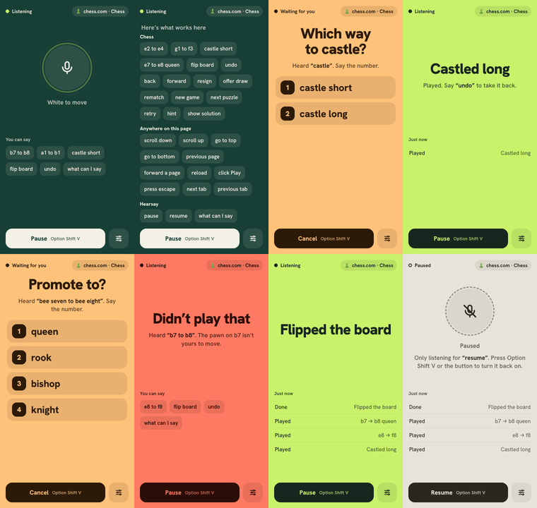
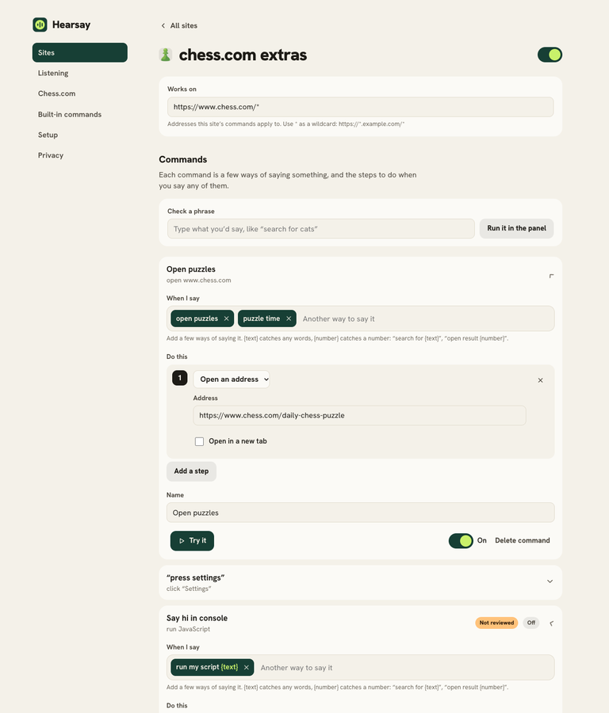

# Hearsay

This is a one shotted project with Claude Opus 5.5 and some skills for [this person](https://www.reddit.com/r/chrome_extensions/comments/1x9md07/comment/phnb6jl/).

Voice control for Chrome that ships with chess defaults.

Say **“e2 to e4”** and the move is played on chess.com or lichess: live games, bots, puzzles and analysis. Then give any other website its own voice commands, with no code unless you want it.

Hearsay started as a replacement for a chess.com voice extension that stopped working, for a player with carpal tunnel in both hands. The goal is a whole game without touching the mouse.



## Install

1. Download `hearsay-v1.1.0.zip` from the [latest release](../../releases/latest) and unzip it.
2. Open `chrome://extensions` and turn on **Developer mode** (top right).
3. Click **Load unpacked** and choose the unzipped folder.
4. A welcome tab opens. Allow the microphone, open the panel, and say your first move.

Needs Chrome 138 or newer.

## Playing chess

Open a board on chess.com or lichess.org, open the Hearsay panel (toolbar icon or <kbd>Alt</kbd><kbd>Shift</kbd><kbd>H</kbd>) and talk.

| Say | What happens |
| --- | --- |
| “e2 to e4”, “e two e four”, “e2e4” | Plays the move |
| “bee two to bee four”, “echo two to echo four” | Spelled letters and NATO words work |
| “e7 to e8 queen” | Promotes. Leave the piece out and Hearsay asks |
| “castle short”, “castle long”, “O-O” | Castles. Plain “castle” asks if both are legal |
| “one”, “two” | Picks an option when Hearsay asks “Which one?” |
| “undo”, “flip board”, “rematch”, “next puzzle”, “hint”, “resign” | Presses that button (resign asks first) |
| “pause”, “resume” | Pauses. While paused Hearsay only listens for “resume” |
| “what can I say” | Lists every command for the page you’re on |

Hearsay listens against the position. It knows every legal move at that moment, so when the recognizer hears “a2 to 84” or “b2 before”, it plays the one legal move that could mean (a2 to a4, b2 to b4). If what you said isn’t legal, it tells you why and plays nothing. When it’s the other side’s turn your move becomes a premove.

Piece names (“knight f3”) are off by default and can be turned on in settings. So can a “yes or cancel” confirmation before each move, for slow games.

The panel’s color is its state, so you can read it from the corner of your eye: **pine** listening, **lime** done, **apricot** waiting for your answer, **coral** didn’t work, **stone** paused.

<kbd>Alt</kbd><kbd>Shift</kbd><kbd>V</kbd> starts and pauses listening from anywhere. Both shortcuts can be changed at `chrome://extensions/shortcuts`, which also means a foot pedal or accessibility switch mapped to a key works.

## Voice commands for any site



Open **Settings → Sites**, or press **Add commands for this site** in the panel while you’re on it. A command is a few ways of saying something and the steps to run when you say any of them:

- **Click something.** Press *Pick on the page*, then click the button you mean. Hearsay remembers it, falling back to its text if the page changes.
- **Press keys.** Click the box and press the shortcut.
- **Type text**, optionally pressing Enter afterwards.
- **Open an address**, like `https://www.youtube.com/results?search_query={text}`.
- **Scroll** or **wait**.
- **Run JavaScript**, for everything else.

Phrases can have blanks: `search for {text}` catches any words, `open result {number}` catches a number. Blanks fill in the steps.

Templates for YouTube, Wikipedia and Google Search show the idea and can be edited. **Check a phrase** shows which command a sentence would run, and **Try it** runs a command on the open tab.

Everyday commands (“scroll down”, “go back a page”, “next tab”, “click Subscribe”) work on chess.com and every site you’ve added. When “click” matches several things, Hearsay numbers them on the page and you say the number. You can turn them on for every website in settings.

### JavaScript steps and Gemini Nano

JavaScript runs through Chrome’s user scripts API. Chrome requires you to switch that on yourself: open Hearsay’s details at `chrome://extensions` and turn on **Allow User Scripts**. Settings → Setup links straight there.

If your computer has Chrome’s built-in model, Gemini Nano, you can describe what you want and it drafts the code. It runs on your computer, needs no account or key, and reads an outline of the open page’s buttons so it uses real selectors. The draft goes into the editor for you to read before it ever runs. Chrome downloads the model (about 2 GB) the first time; see [Chrome’s hardware requirements](https://developer.chrome.com/docs/ai/prompt-api#hardware-requirements).

### Sharing packs

Export a site, or all of them, as a JSON pack and share it. Importing shows what a pack contains first, and any command that runs JavaScript stays off until you’ve read the code and turned it on. The format:

```json
{
  "hearsay": 1,
  "sites": [{
    "name": "YouTube",
    "match": ["https://www.youtube.com/*"],
    "commands": [{
      "name": "Search YouTube",
      "phrases": ["search for {text}"],
      "steps": [{ "type": "url", "url": "https://www.youtube.com/results?search_query={text}" }]
    }]
  }]
}
```

Step types: `click` (`selector`, `text`), `keys` (`keys`, like `Shift+N`), `type` (`text`, `selector`, `submit`), `url` (`url`, `newTab`), `scroll` (`direction`: `down`, `up`, `top`, `bottom`), `wait` (`ms`), `js` (`code`, `world`: `USER_SCRIPT` or `MAIN`). Inside JavaScript, `slots.text` and `slots.number` hold the blanks. More examples live in [`packs/`](packs).

## Privacy

- No servers, no account, no analytics. Settings and commands stay in this browser.
- Speech becomes text in Chrome. With on-device recognition (Settings → Listening) audio never leaves your computer. Otherwise Chrome’s online speech service handles it, as with voice search.
- Hearsay listens only while its panel is open.

### Why each permission

| Permission | Used for |
| --- | --- |
| Microphone | Hearing you. Granted once, to the extension, not to each site |
| chess.com access | Reading the board and clicking squares |
| Tabs | Knowing which site you’re on, to pick its commands |
| Scripting | Running your site commands and the element picker |
| User scripts | “Run JavaScript” steps, only after you allow them |
| Other sites (optional) | Asked per site when you add it |
| Side panel, storage, favicon | The panel, your settings, site icons in settings |

## Development

No build step. Clone, run `npm install` for the test tools, and load the folder unpacked.

```bash
npm test
```

Runs the unit tests: move generation (perft-checked), the speech-to-move parser, and phrase matching.

```bash
npm run test:e2e
```

Loads the extension into Chromium and plays real moves on chess.com, so it needs a network connection. The HTML report lands in `e2e-report/`.

See [CONTRIBUTING.md](CONTRIBUTING.md) for how the pieces fit together.

## License

MIT. Hanken Grotesk is under the SIL Open Font License (see `fonts/OFL.txt`). Hearsay is not affiliated with chess.com.
